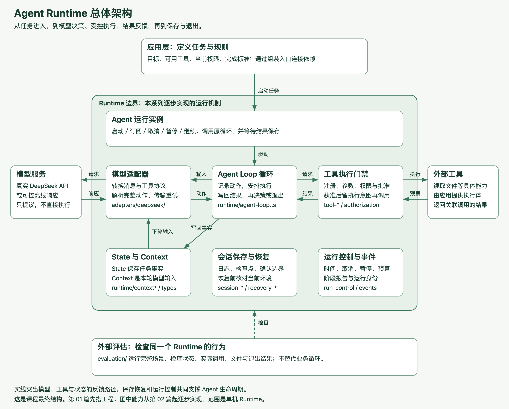
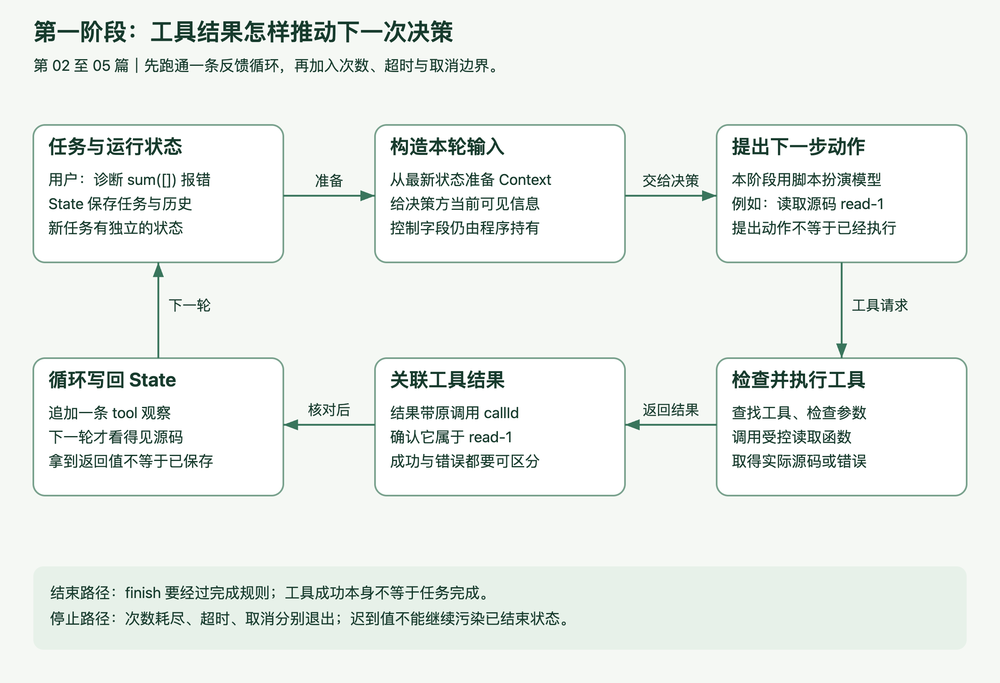
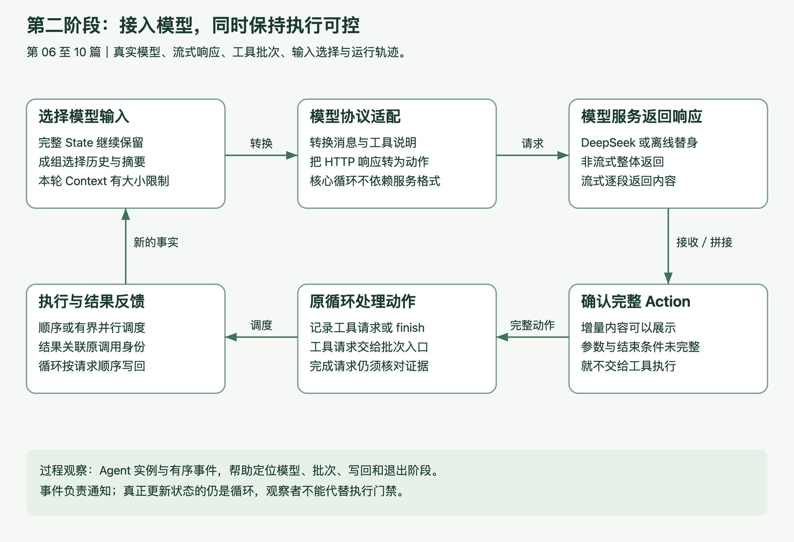
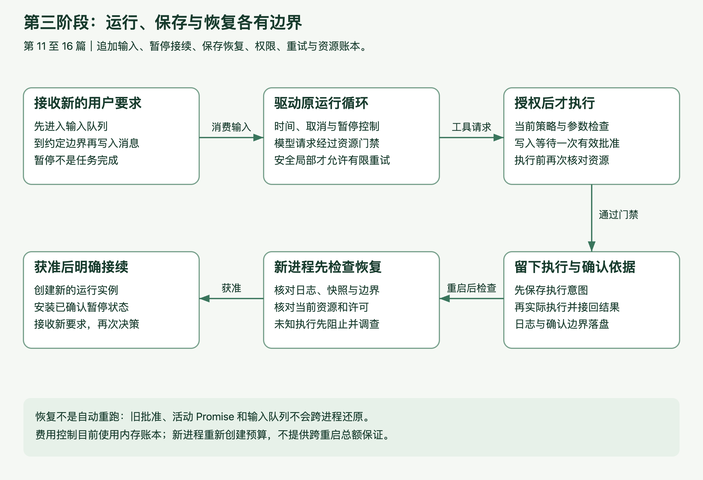
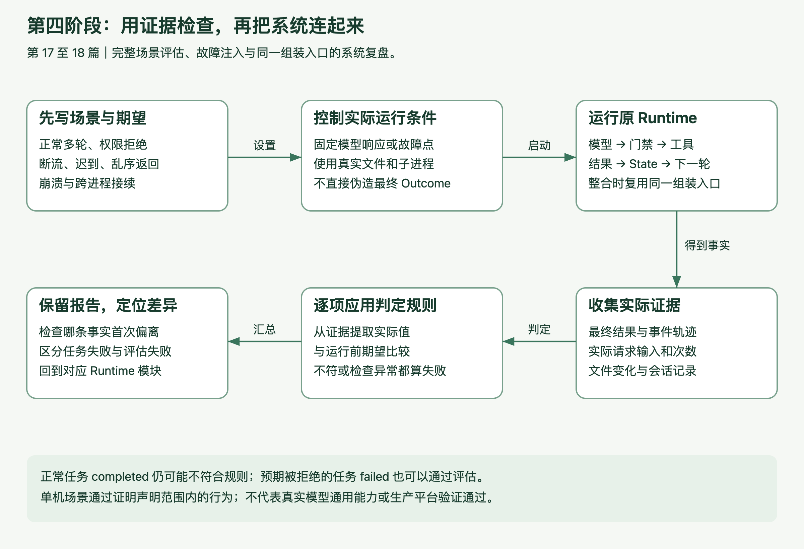

# 从零实现 Agent Runtime：用 TypeScript 把模型、工具和任务运行连起来

Agent 能调用工具之后，接下来会遇到什么？

文件读出来了，下一轮模型却还在重复读取。用户已经取消任务，工具稍后仍然返回结果。程序写完文件突然退出，下次启动时不知道该继续，还是重跑。

这些问题，决定了一个 Agent 能不能持续做事，也决定了出错以后我们能不能找到原因。

这个系列从零实现一个 Agent Runtime，沿着一条具体任务，把模型决策、工具执行、状态反馈、权限、预算和恢复逐步连接起来。

## 从一个代码问题开始

假设有这样一项任务：

> `sum([])` 在空数组时抛错，请读取源码和测试，找出原因。

模型首先提出读取源码。程序检查工具和参数，取得真实文件内容，把结果保存下来，再交给下一轮模型。模型结合观察继续选择动作，直到满足完成条件，或者明确失败、暂停、取消。

其中，谁来安排下一轮？谁保存工具结果？谁判断一个请求是否可以执行？

负责管理这段过程的程序，就是这里要实现的 Runtime。

应用提供目标、工具和规则。Runtime 驱动执行过程。模型根据输入提出动作，工具完成获准的具体操作。任务记录、控制机制和会话存储共同支撑这条过程。

这张图也是整套课程的地图。实现从中间的反馈循环开始，每加一项能力，都回到同一条任务上观察它改变了什么。

## 第一阶段：让工具结果推动下一步

第 02 至 05 篇先建立 Agent 的运行主干。

从“提出读取请求”到“实际取得源码”，再到“把结果交给下一次决策”，亲手实现第一条反馈循环。接着分清程序保存的 State 与模型本轮可见的 Context，为工具建立注册、参数检查和结果关联，最后加入超时与取消。

图中最重要的是左侧回路：结果先由循环写进 State，再参与下一轮输入构造。省略写回，工具即使已经读到源码，决策方仍可能使用旧信息。

这一阶段关注几个具体问题：

- 工具执行成功，为什么还不能直接宣布任务完成？
- 返回值已经拿到了，为什么模型仍可能不知道？
- 一个请求一直不返回，次数上限为什么无法让它停下？
- 工具晚于取消返回，结果还能不能写进历史？

把这些关系连起来，才能理解后面每个控制模块究竟在保护什么。

## 第二阶段：连接真实模型，看见完整过程

第 6 至 10 篇，把已有循环接到 DeepSeek，并逐步加入流式响应、工具批次、输入选择和运行事件。

模型协议放在适配器中处理。核心循环接收完整动作，继续沿用原来的工具和状态机制。

流式响应需要区分“已经显示了一段文字”与“已经拿到可以执行的调用”。多个工具并行时，需要分别定义完成顺序和保存顺序。历史越来越长时，需要决定模型这次看见哪些信息，而完整任务记录仍然保留。

模型协议与流式分片在进入核心循环前处理；工具结果仍沿原反馈路径回来。并行改变执行时序，不应改变结果属于哪个请求。

事件与轨迹则让这些过程可以定位：模型请求到了哪一轮，哪个批次开始了，结果有没有写回，任务最后为什么退出。

## 第三阶段：让任务有控制地运行、保存和恢复

第 11 至 16 篇，处理任务持续运行时会出现的问题。

用户中途补充要求，程序要在明确的位置接收；任务暂停，不能伪装成已经完成；结果写进会话日志后，另一个进程才能检查已有事实。

恢复尤其需要谨慎。工具可能已经改变了外部文件，却没有留下正常返回结果。此时直接重跑，可能重复执行同一个动作。课程会为执行留下意图与确认依据，恢复前核对当前资源和权限，对无法确认的情况先阻止。

权限与批准、错误分类、安全重试、请求与 token 记账，也会在已有执行入口中逐项加入。每项机制都有自己的触发条件和退出结果，不用一个模糊的“失败”把问题全部盖过去。

上半部分控制当前任务怎么继续，下半部分解释进程重启以后凭什么接续。恢复检查通过后才安装旧暂停状态，无法确认的执行不能自动重放。

## 第四阶段：用故障检查，把系统重新连起来

第 17 篇建立完整场景的验证：主动制造断流、权限拒绝、迟到结果、乱序完成和崩溃恢复，再检查实际输入、状态、文件与调用次数。

第 18 篇回到最初的诊断任务，让已有模块经过同一个组装入口。沿着一条正常轨迹定位源码，再观察拒绝、取消、预算不足和新进程接续分别停在哪里。

评估从外部运行原 Runtime，并根据实际证据得出结论。检查规则不会替循环执行工具，也不会把一条失败结果直接改成成功。

至此，课程形成一套可以在本地运行、记录过程、检查失败边界的单机 Agent Runtime。

## 怎么跟着实现

整个系列包含第 01 篇工程准备，以及第 02 至 18 篇实战。

每篇提供要新增或修改的文件、连续可复制的代码、关键中文注释、代码下方的解释，以及运行与调试方法。复杂功能先说明具体任务遇到了什么问题，再沿正常过程追踪数据，随后分析失败路径。

实现使用 TypeScript。需要基础编程经验，能阅读函数、对象和数组，并执行基本终端命令；Agent 相关术语会结合实际对象解释。

自己的机制运行清楚后，再对照 Pi Agent Core 对应的局部源码，比较状态、输入、工具、事件与生命周期的边界。课程借鉴它处理工程问题的方式，保留自己已经明确的实现范围。

最终作品是单机 Runtime。完整 Coding Agent、分布式调度、生产沙箱和跨重启费用控制还需要进一步工程；固定场景通过，也不代表模型已经能够修复任意项目。

可以从第 01 篇的架构图开始，先认清一条任务怎样经过这些模块，再写出第一条反馈循环。
